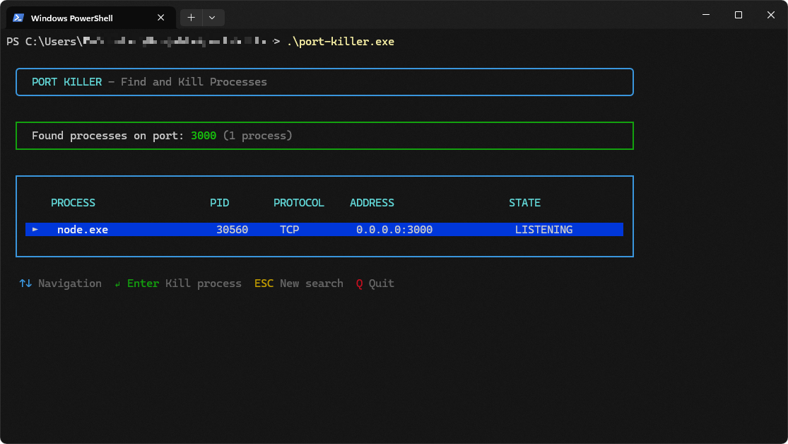

# port-killer



Find out which process is using a port and kill it, in an interactive terminal UI.

`port-killer` lists every process that has a TCP or UDP socket on the port you enter, with process name, PID, address and connection state. Pick one and press Enter to kill it. It runs on Windows, Linux and macOS.

## Installation

**Linux and macOS**

```sh
curl --proto '=https' --tlsv1.2 -fsSL https://raw.githubusercontent.com/DaBorsten/port-killer/master/install.sh | sh
```

**Windows (PowerShell)**

```powershell
irm https://raw.githubusercontent.com/DaBorsten/port-killer/master/install.ps1 | iex
```

The installer downloads the right binary for your system from the latest release and checks it against the published SHA-256 checksum. It also puts the install directory on your `PATH`, so `port-killer` works in any new terminal:

| OS            | Installs to                                      | PATH is set in                                        |
| ------------- | ------------------------------------------------ | ----------------------------------------------------- |
| Linux, macOS  | `~/.local/bin/port-killer`                       | your shell profile (`.zshrc`, `.bashrc`, `.bash_profile`, fish config or `.profile`) |
| Windows       | `%LOCALAPPDATA%\port-killer\bin\port-killer.exe` | the user `Path` environment variable (no admin rights needed) |

Run the same command again to update. You can set these environment variables to change the defaults:

| Variable                     | Effect                                    |
| ---------------------------- | ----------------------------------------- |
| `PORT_KILLER_VERSION`        | Install a specific release, e.g. `v0.1.0` |
| `PORT_KILLER_INSTALL_DIR`    | Install somewhere else                    |
| `PORT_KILLER_NO_MODIFY_PATH` | Set to `1` to leave your `PATH` alone     |

```sh
curl --proto '=https' --tlsv1.2 -fsSL https://raw.githubusercontent.com/DaBorsten/port-killer/master/install.sh | PORT_KILLER_VERSION=v0.1.0 sh
```

### Manual download

Each [release](https://github.com/DaBorsten/port-killer/releases/latest) has these archives and a `SHA256SUMS.txt`. Unpack the archive and put `port-killer` (`port-killer.exe` on Windows) in a directory on your `PATH`.

| Platform            | Archive                                         |
| ------------------- | ----------------------------------------------- |
| Linux x86_64        | `port-killer-x86_64-unknown-linux-musl.tar.gz`  |
| Linux ARM64         | `port-killer-aarch64-unknown-linux-musl.tar.gz` |
| macOS Intel         | `port-killer-x86_64-apple-darwin.tar.gz`        |
| macOS Apple Silicon | `port-killer-aarch64-apple-darwin.tar.gz`       |
| Windows x86_64      | `port-killer-x86_64-pc-windows-msvc.zip`        |
| Windows ARM64       | `port-killer-aarch64-pc-windows-msvc.zip`       |

The macOS binary is not notarized. If you downloaded it in a browser and Gatekeeper blocks it, run `xattr -d com.apple.quarantine ./port-killer`. The install script does not have this problem.

### Verifying a download

Every archive comes with a signed [build provenance attestation](https://docs.github.com/en/actions/security-for-github-actions/using-artifact-attestations). It proves that the file was built by this repository's release workflow from the tagged commit. You can check it with the [GitHub CLI](https://cli.github.com/):

```sh
gh attestation verify port-killer-x86_64-unknown-linux-musl.tar.gz --repo DaBorsten/port-killer
```

Releases are immutable: once published, their files cannot be replaced.

### From source

```sh
cargo install --git https://github.com/DaBorsten/port-killer
```

### Uninstall

Delete the binary. If you want, also remove the `PATH` entry the installer added: the line marked `# Added by the port-killer installer` in your shell profile, or `%LOCALAPPDATA%\port-killer\bin` from your user `Path` on Windows.

## Usage

```sh
port-killer          # asks for a port
port-killer 3000     # searches port 3000 right away
```

| Key       | Action                          |
| --------- | ------------------------------- |
| `0`–`9`   | Type the port                   |
| Enter     | Search, or kill the selected process |
| ↑ ↓ / `k` `j` | Move the selection          |
| `r`       | Refresh the list                |
| Esc       | Start a new search (quits on the port input) |
| `q`, Ctrl+C | Quit                          |

```text
Options:
  -h, --help     Print help
  -V, --version  Print version
```

Processes are killed immediately, without asking first (`SIGKILL` on Linux and macOS, `TerminateProcess` on Windows). You can only kill processes you have permission for. To kill system services or processes of other users, run `port-killer` as administrator or with `sudo`.

## Development

```sh
cargo run -- 3000
```

To have something to kill, start the bundled test server (`cargo run --example test-server -- 3000 Server-1`). On Windows, `.\start-test-servers.ps1` starts four of them on ports 3000, 3001, 3002 and 8080, and `.\stop-test-servers.ps1` stops them again.

## Releasing

1. Bump `version` in `Cargo.toml` and run `cargo build` so `Cargo.lock` is updated.
2. Commit, then tag and push:

   ```sh
   git tag v0.1.0
   git push origin master v0.1.0
   ```

The [Release workflow](.github/workflows/release.yml) checks that the tag matches the crate version, builds all targets, attests them, and publishes a GitHub release with the archives and checksums. It then verifies the attestations and runs both install scripts against the new release on Linux, macOS and Windows.

Because releases are immutable, a published tag cannot be reused. If something is wrong with a release, publish a new patch version.

## License

[MIT](LICENSE)
